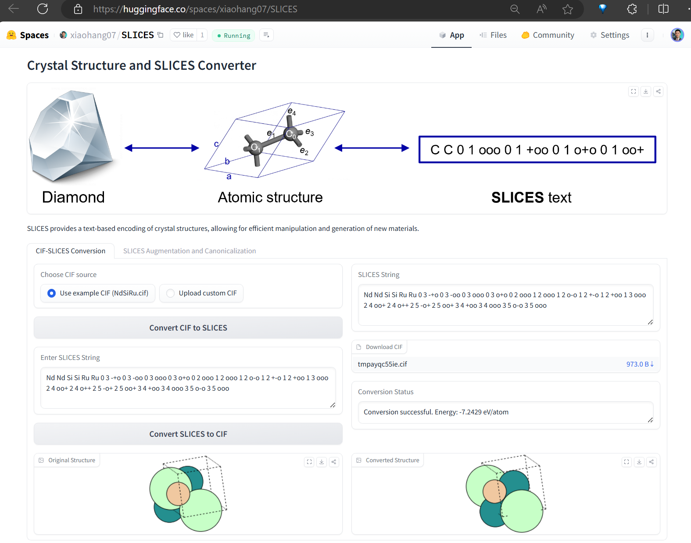
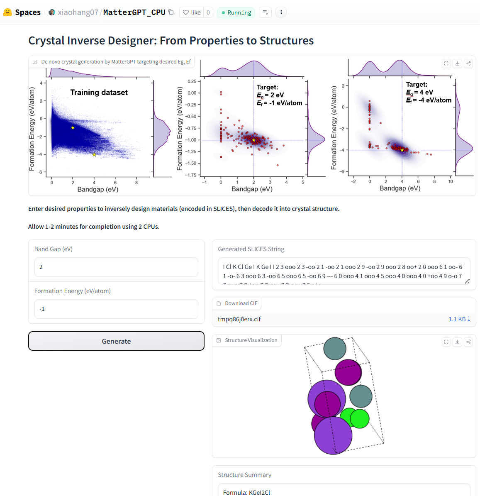
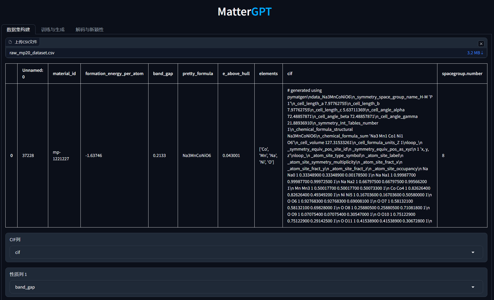
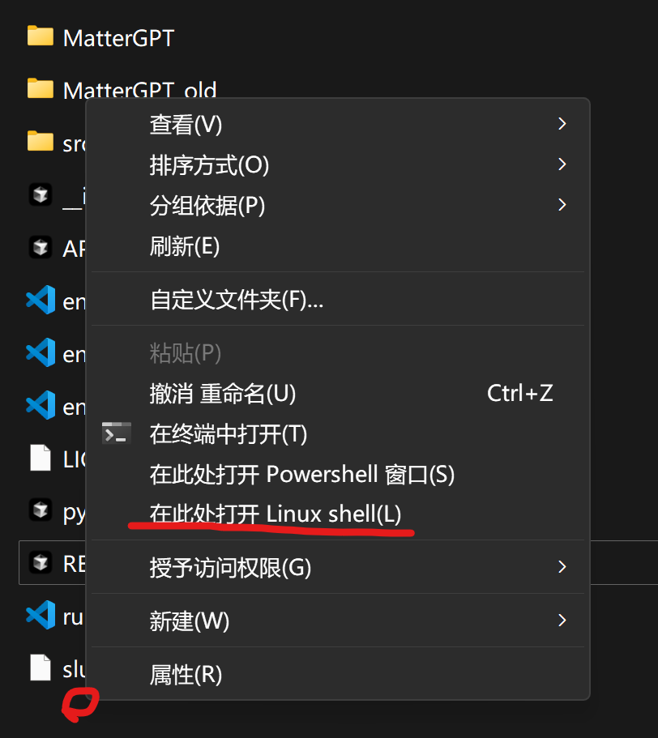

# Simplified Line-Input Crystal-Encoding System (SLICES)

The **Simplified Line-Input Crystal-Encoding System (SLICES)** is the first invertible and invariant crystal representation tool. This software supports encoding and decoding crystal structures, reconstructing them, and generating new materials with desired properties using generative deep learning.

**Related Publications and Resources:**
- **Nature Communications**: [Paper](https://www.nature.com/articles/s41467-023-42870-7)
- **MatterGPT 图形界面介绍**: [Bilibili](https://www.bilibili.com/video/BV15XrmYMEYU/)
- **SLICES 晶体语言介绍**: [Bilibili](https://www.bilibili.com/video/BV17H4y1W7aZ/)
- **SLICES 101**: [Bilibili](https://www.bilibili.com/video/BV1Yr42147dM/)
- **MatterGPT Paper**: [arXiv](https://arxiv.org/abs/2408.07608)
- **MatterGPT Demo**: [Huggingface](https://huggingface.co/spaces/xiaohang07/MatterGPT_CPU)
- **SLICES-PLUS Paper**: [arXiv](https://arxiv.org/abs/2410.22828)
- **Data and Results**: [Figshare](https://doi.org/10.6084/m9.figshare.22707472)
- **完整的Materials Project新颖性检查库和EAH计算竞争相库**: [Figshare](https://doi.org/10.6084/m9.figshare.28645331) 
方便大家在整个MP数据库中进行新颖性检查和计算EAH！
---

## Main Functionalities

1. **Encode crystal structures into SLICES strings**
2. **Reconstruct original crystal structures (Text2Crystal)**
3. **Inverse design of solid-state materials with desired properties using MatterGPT**
4. **Inverse design of solid-state materials with desired properties and crystal systems using MatterGPT ([SLICES-PLUS](https://arxiv.org/abs/2410.22828))**

---
We provide a huggingface space to allow one-click conversion of CIF to SLICES and SLICES to CIF online. 
### [[Online SLICES/CIF Convertor]](https://huggingface.co/spaces/xiaohang07/SLICES)
[](https://huggingface.co/spaces/xiaohang07/SLICES "Online SLICES/CIF Convertor - Click to Try!")
### [[MatterGPT Online Demo]](https://huggingface.co/spaces/xiaohang07/MatterGPT_CPU)
[](https://huggingface.co/spaces/xiaohang07/MatterGPT_CPU "MatterGPT Online Demo - Click to Try!")
### MatterGPT 图形界面 

---

## Table of Contents

1. [Installation](#installation)
   - [Local Installation](#local-installation)
   - [Docker Installation](#docker-installation)
2. [Examples](#examples)
   - [Crystal to SLICES and SLICES to Crystal](#crystal-to-slices-and-slices-to-crystal)
   - [Augment SLICES and Canonicalize SLICES](#augment-slices-and-canonicalize-slices)
3. [Tutorials](#tutorials)
    - **MatterGPT图形界面**: [Bilibili](https://www.bilibili.com/video/BV15XrmYMEYU/)
    - [MatterGPT脚本教程](./MatterGPT/tutorials_CN.sh)

    - **SLICES Video Tutorials**: [Bilibili](https://space.bilibili.com/398676911/channel/seriesdetail?sid=4012344)(#tutorials-for-docker-installation)
4. [Documentation](#documentation)
5. [Reproducing Benchmarks](#reproducing-benchmarks)
6. [Citation](#citation)
7. [Acknowledgements](#acknowledgement)
8. [Contact and Support](#contact-and-support)

---

## Installation
可以选择 1.本地安装 **或者** 2.docker安装。
## Local Installation
本地安装指南（Ubuntu 或者 Win11 的 WSL2 Ubuntu 子系统）。环境由 [uv](https://docs.astral.sh/uv/) 管理：Python 3.10 由 uv 自动下载，不需要 conda；所有依赖的确切版本锁定在 `uv.lock` 中，每台机器装出来的环境完全一致。PyPI 默认使用清华镜像（在 `pyproject.toml` 中配置），PyTorch 从官方源下载。

### 1.1 安装 uv
**如果已经装好 uv，可以跳过这一步。**

```bash
curl -LsSf https://astral.sh/uv/install.sh | sh
# 如果上面的命令下载慢，也可以用已有的 pip 从清华镜像安装：
# pip install uv -i https://pypi.tuna.tsinghua.edu.cn/simple
```
安装后重新打开终端，运行 `uv --version` 确认安装成功。

### 1.2 下载 SLICES 仓库并安装环境
根据你的硬件选择一个 PyTorch 版本（三选一）：
- `--extra cu128`：NVIDIA 显卡，**50 系显卡必须用这个**；
- `--extra cu126`：NVIDIA 显卡，驱动较老、不支持 CUDA 12.8 时使用；
- `--extra cpu`：没有 NVIDIA 显卡。

```bash
wget https://github.com/xiaohang007/SLICES/archive/refs/heads/main.zip -O slices_repo.zip
unzip slices_repo.zip
cd SLICES-main
uv sync --extra cu128              # 按上面的说明换成 cu126 或 cpu
source .venv/bin/activate          # 激活环境；之后的命令都在这个环境里运行
python -m slices.relax_backends --prepare   # 首次使用：下载并在本机编译 NequIP 力场模型
```
安装完成！

- 环境装在仓库目录下的 `.venv` 中。每次打开新终端后，进入仓库目录运行 `source .venv/bin/activate`；也可以不激活，在命令前加 `uv run`，例如 `uv run python app.py`。
- 可以同时加多个可选组件，例如 `uv sync --extra cu128 --extra gui`（图形界面，见 1.4）或 `--extra oeq`（OpenEquivariance，NVIDIA 显卡上可进一步加速 NequIP）。
- `uv sync` 会让环境与 `uv.lock` 完全一致，手动用 `uv pip install` 装的额外包会被移除；如需保留，用 `uv sync --inexact`。
- flash-attn 不再随环境安装（目前没有适配 torch 2.9 的预编译包）。MatterGPT 检测不到 flash-attn 时会改用 PyTorch 自带的 `scaled_dot_product_attention`，结果相同。
- 只有 CPU 时训练 MatterGPT 很耗内存：教程中 `batch_size=36` 约需 13 GB，16 GB 内存的电脑（包括 WSL）建议把 `BATCH_SIZE` 改为 8（约 5.5 GB），否则可能把系统内存耗尽。

### 1.3 NequIP 力场（解码最后一步的结构弛豫）
`SLICES(relax_model="auto")`（默认）会自动选择力场：
- 检测到 CUDA GPU：用 NequIP-OAM-L 弛豫；
- 没有 GPU：用 NequIP-OAM-S 弛豫，再用 NequIP-OAM-L 算一次能量，CPU 上速度与以前的 M3GNet 相当。

所有方案的能量都来自 NequIP-OAM-L，因此 GPU 和 CPU 机器的结果可以直接比较。

- 编译好的模型与本机 GPU、CUDA、torch、nequip 版本绑定，缓存在 `~/.cache/slices/nequip`，换机器需要重新运行 `--prepare`。
- 在开多个并行解码进程之前先运行一次 `--prepare`，避免第一次运行时等待编译。
- 也可以显式指定 `relax_model="nequip-l"`、`"nequip-s+l"` 或 `"nequip-m+l"`，或者设置环境变量 `SLICES_RELAX_MODEL`、`SLICES_DEVICE=cpu|cuda`。完整说明见 `src/slices/relax_backends.py`。
- M3GNet 已移除，不再安装 TensorFlow。

### 1.4 访问图形界面
```bash
uv sync --extra cu128 --extra gui   # 安装图形界面所需的 gradio（cu128 换成你在 1.2 中的选择）
cd MatterGPT
python app.py
```
按住 `CTRL` (或 Mac 上的 `Command`)，然后点击terminal中的 `http://localhost:7860`链接来打开MatterGPT的图形界面。


如果想用Docker来跑SLICES的环境，可以选择下面的安装方法：
### Docker Installation

> 注意：Docker 镜像 v12 仍是旧环境（包含 M3GNet 的旧版 SLICES），还没有更新到上面的 uv 环境。

请按照以下步骤使用 Docker 安装 SLICES:

**Windows系统下的准备工作**：
如果是win11的系统，需要先安装WSL2的ubuntu系统，然后安装Docker Desktop,并且在选项里面开启WSL2 ubuntu访问本机的docker，然后按照下图按住shift右键点击圆圈处，然后选择在此处打开linux shell



**Linux系统下的准备工作**：安装docker就可以了。

---

1. **下载仓库**，并解压文件。
```bash
wget https://github.com/xiaohang007/SLICES/archive/refs/heads/main.zip -O slices_repo.zip
unzip slices_repo.zip
cd SLICES-main
```

2. **在 `slurm.conf`中配置 CPU 线程数量。例如下面是设置为16**
```bash
sed -i 's/CPUs=8/CPUs=16/' slurm.conf
```
3. **执行 Docker 集成命令：**
```bash
# 从 Docker Hub 下载已经构建的 SLICES Docker 镜像
docker pull xiaohang07/slices:v12

# 如果 docker pull 不管用，您可以在 https://figshare.com/s/260701a1accd0192de20 下载压缩的 docker 镜像 v12。

# 然后，使用以下命令4线程并行解压缩以及加载此 docker 镜像：
xz -T4 -dc dockerv12.tar.xz | docker load

# 您也可以使用此仓库中的 Dockerfile 构建自己的 docker 镜像。感谢 Haidi Wang 教授 (https://haidi-ustc.github.io/about/) 提供的 Dockerfile。

# 使脚本具有执行权限
sudo chmod +x entrypoint_set_cpus_gradio.sh entrypoint_set_cpus.sh

# 运行 Docker
docker run -it -p 7860:7860 -h workq --shm-size=0.5gb --gpus all -v ./:/crystal xiaohang07/slices:v12 /crystal/entrypoint_set_cpus_gradio.sh
```

5. **访问图形界面**:

   - 按住 `CTRL` (或 Mac 上的 `Command`)，然后点击terminal中的 `http://localhost:7860`链接来打开MatterGPT的图形界面。

---

### 注意
- **Windows 11**：使用完全支持 GPU 的 Docker 环境。

- **Ubuntu**：使用本地安装更好，因为 nvidia-docker 比较难安装。


---

## Examples

### Crystal to SLICES and SLICES to Crystal
Convert a crystal structure to its SLICES string and reconstruct it.

```python
from slices.core import SLICES
from pymatgen.core.structure import Structure

# Load crystal structure from file
original_structure = Structure.from_file(filename='NdSiRu.cif')
backend = SLICES()

# Convert to SLICES string
slices_NdSiRu = backend.structure2SLICES(original_structure)

# Reconstruct crystal and get predicted energy
reconstructed_structure, final_energy_per_atom = backend.SLICES2structure(slices_NdSiRu)

print('SLICES string of NdSiRu is:', slices_NdSiRu)
print('Reconstructed structure:', reconstructed_structure)
print('Final energy per atom:', final_energy_per_atom, 'eV/atom')
```

### Augment SLICES and Canonicalize SLICES
Generate augmented SLICES strings and reduce them to a canonical form.

```python
from slices.core import SLICES
from pymatgen.core.structure import Structure

# Load crystal structure
original_structure = Structure.from_file(filename='Sr3Ru2O7.cif')
backend = SLICES(graph_method='econnn')

# Generate augmented SLICES
slices_list = backend.structure2randomSLICES(structure=original_structure, num=50, shuffle_bond_order=False, flip_bonds=False)
canonical_slices = list(set(backend.get_canonical_SLICES(s) for s in slices_list))

print('Unique Canonical SLICES:', len(canonical_slices))
```
---

## Documentation
The official documentation is available at [Read the Docs](https://xiaohang007.github.io/SLICES/).

---

## Reproducing Benchmarks
Refer to the [Benchmarks Guide](benchmark/benchmarks.md) for detailed instructions.

---

## Citation

If you use SLICES, MatterGPT or SLICES-PLUS, please cite the following works:

```bibtex
@article{xiao2023invertible,
  title={An invertible, invariant crystal representation for inverse design of solid-state materials using generative deep learning},
  author={Xiao, Hang and Li, Rong and Shi, Xiaoyang and Chen, Yan and Zhu, Liangliang and Chen, Xi and Wang, Lei},
  journal={Nature Communications},
  volume={14},
  number={1},
  pages={7027},
  year={2023},
  publisher={Nature Publishing Group UK London}
}

@misc{chen2024mattergptgenerativetransformermultiproperty,
  title={MatterGPT: A Generative Transformer for Multi-Property Inverse Design of Solid-State Materials},
  author={Yan Chen and Xueru Wang and Xiaobin Deng and Yilun Liu and Xi Chen and Yunwei Zhang and Lei Wang and Hang Xiao},
  year={2024},
  eprint={2408.07608},
  archivePrefix={arXiv},
  primaryClass={cond-mat.mtrl-sci},
  url={https://arxiv.org/abs/2408.07608}
}

@misc{wang2024slicespluscrystalrepresentationleveraging,
      title={SLICES-PLUS: A Crystal Representation Leveraging Spatial Symmetry}, 
      author={Baoning Wang and Zhiyuan Xu and Zhiyu Han and Qiwen Nie and Hang Xiao and Gang Yan},
      year={2024},
      eprint={2410.22828},
      archivePrefix={arXiv},
      primaryClass={physics.comp-ph},
      url={https://arxiv.org/abs/2410.22828}, 
}
```

---

## Acknowledgement
Special thanks to the open-source projects and developers that inspired this work:
- [tobascco](https://github.com/peteboyd/tobascco)
- [xtb](https://github.com/grimme-lab/xtb)
- [gfnff](https://github.com/pprcht/gfnff) (bundled GFN-FF library used for SLICES decoding, LGPL-3.0)
- [m3gnet](https://github.com/materialsvirtuallab/m3gnet)
- [chgnet](https://github.com/CederGroupHub/chgnet)
- [molgpt](https://github.com/devalab/molgpt)

---

## Contact and Support
- **Email**: [hangxiao@ln.edu.hk](mailto:hangxiao@ln.edu.hk)
- **ResearchGate**: [Hang Xiao](https://www.researchgate.net/profile/Hang-Xiao-8)
- **Start a Discussion**: [GitHub Discussions](https://github.com/xiaohang007/SLICES/discussions/categories/general)
